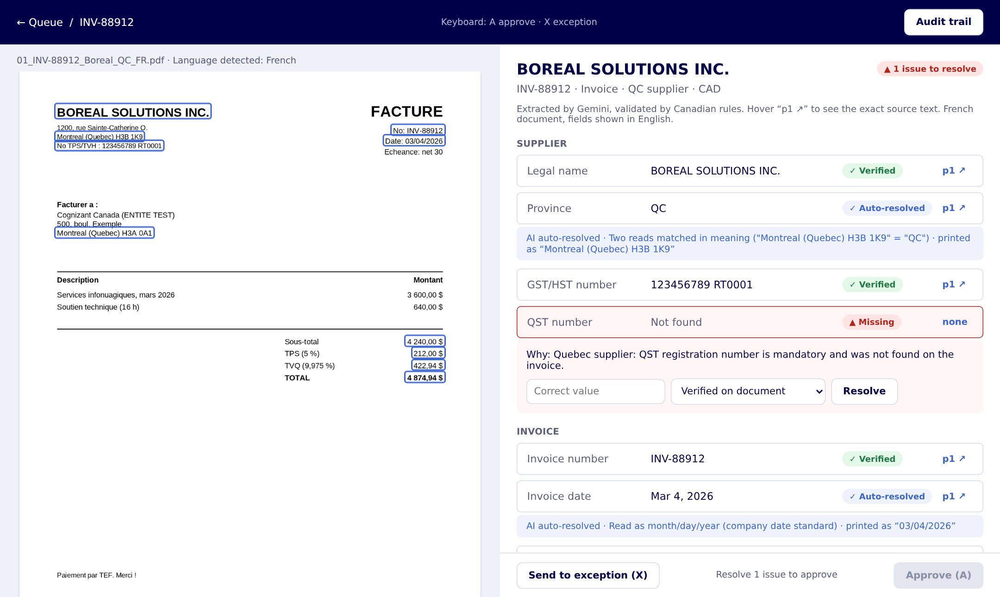
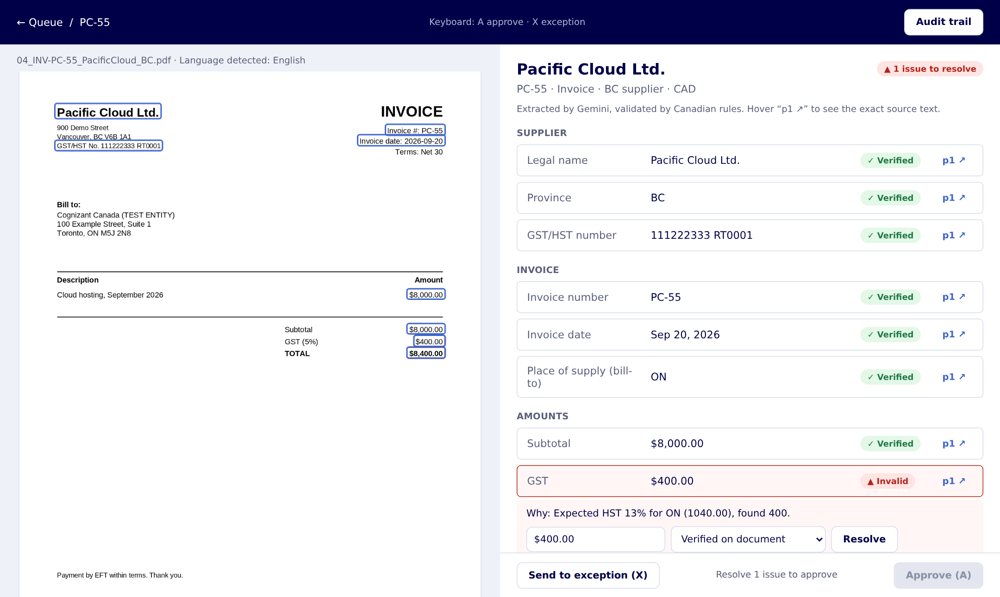
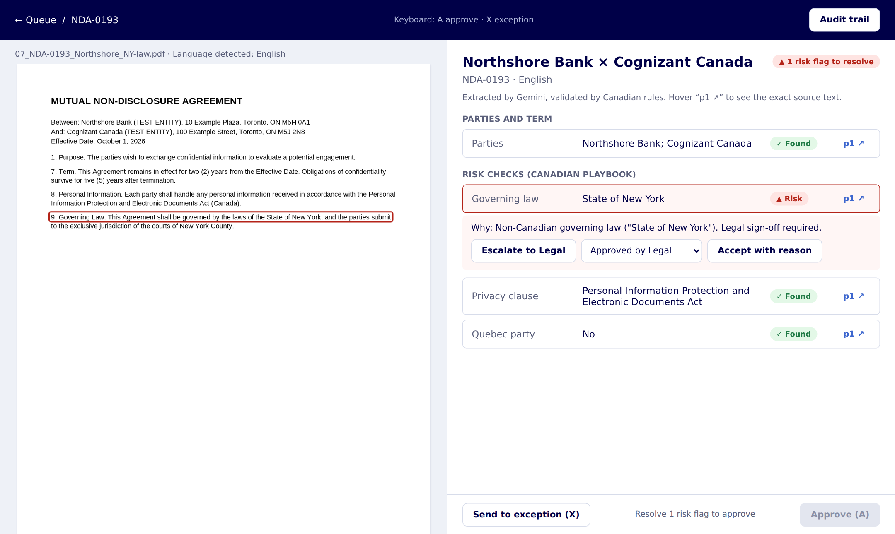
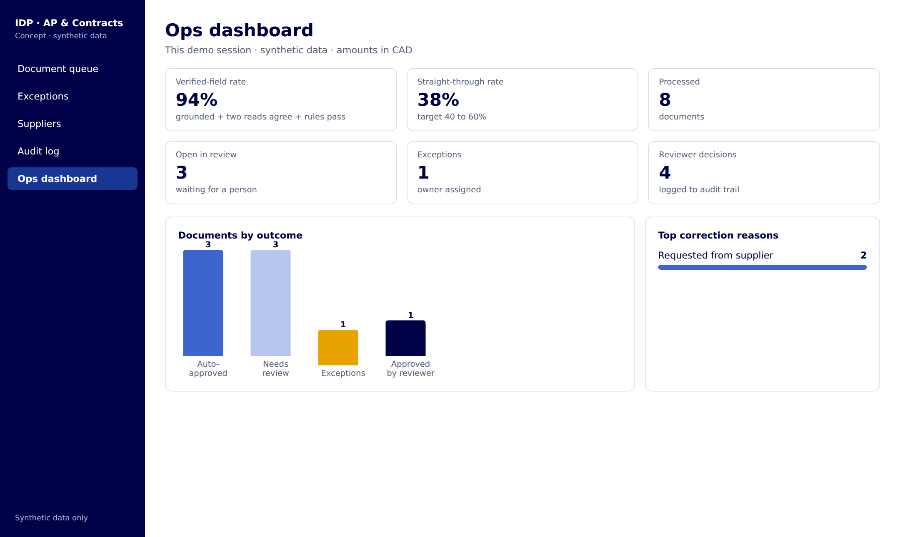
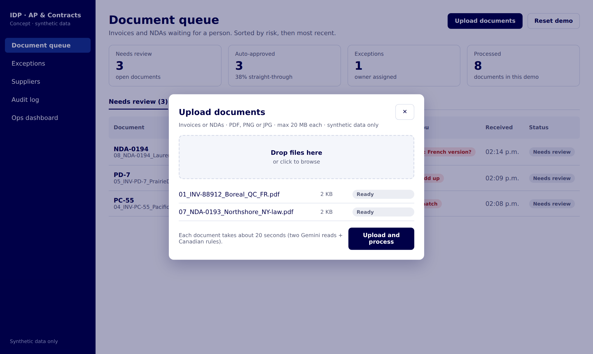
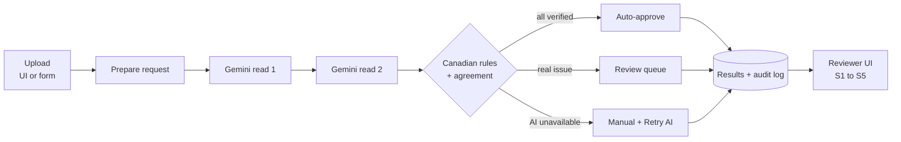

# Intelligent Document Processing for Canadian AP & Contracts

**An AI product case study by Vikram Seenivasan** · Concept project · Synthetic data only

An AI-assisted review tool that reads vendor invoices and NDAs, checks them against Canadian tax and legal rules, and sends a person only the documents that need judgment. Built end to end: discovery, OOUX, wireframes, PRD, a working Gemini + n8n pipeline, and a reviewer UI.

### ▶ [Watch the 90-second demo video](docs/assets/demo.mp4) · [Try the live interactive demo](https://vikram-pm.github.io/idp-canada-ap-contracts/)


📄 **[Full end-to-end case study](docs/CASE_STUDY.md)**: flowchart, wireframes, prototype, usability test and UAT, KPIs, costs, pricing and ROI, enterprise path.

> **Disclaimer:** Personal portfolio project. Not a Cognizant product, not built for or with Cognizant, and contains no Cognizant, client or supplier data. All companies, documents and numbers are fictional.

---

## The problem

Back-office teams rekey 15+ fields per invoice and read every NDA end to end. In Canada the errors are expensive:

- **Four sales-tax regimes** (GST, HST, QST, PST), with the rate set by place of supply.
- **Bilingual documents:** French invoices from Quebec suppliers, with French number formats ("4 874,94 $").
- **Legal context:** provincial governing law, Quebec language requirements, PIPEDA and Quebec Law 25.

**Goal:** cut handling time by 20 to 30% without lowering accuracy, and make every AI decision traceable.

## My role and process

I owned it end to end as product manager and designer:

| Phase | Output |
|---|---|
| Discovery | Problem framing, 5 personas, interview guide, current-state journeys (FigJam) |
| OOUX | Noun foraging, ORCA object map (8 objects), relationships, CTA matrix |
| Design | UX flow and 5 wireframes in Figma, themed with design tokens (variables) |
| Requirements | PRD with 10 user stories, HITL rules, KPIs, responsible AI ([docs/PRD.md](docs/PRD.md)) |
| Build | Gemini + n8n pipeline, Canadian rules engine, reviewer UI served from n8n |
| Test | Synthetic test pack with planted errors, eval script, live runs, iteration |

## The solution

| Screen | What it does |
|---|---|
|  | **Invoice review:** the original PDF with the exact text the AI read outlined (blue verified, amber check, red issue). Small differences are auto-resolved and explained. Approve stays disabled until real issues are resolved. |
|  | **Canadian rules:** a BC supplier billing Ontario charged 5% GST; place of supply requires 13% HST. Flagged with expected vs found amounts. |
|  | **NDA review:** a non-Canadian governing law always goes to Legal. The AI summarises; people decide. |
|  | **Audit trail:** every AI and human action, append-only, retained 6+ years for CRA. |
|  | **Ops dashboard:** verified-field rate, straight-through rate, outcomes, top correction reasons. |
|  | **Upload:** multi-file upload or drag-and-drop anywhere on the queue. |

## How the AI earns trust

The model's self-reported confidence is not used. A field is **Verified** only when all three checks pass:

1. **Grounded:** Gemini returns the exact source text it read the value from.
2. **Consistent:** a second, independent read agrees, compared by meaning ("Quebec" = "QC", "4 874,94 $" = "$4,874.94").
3. **Valid:** deterministic Canadian rules pass. Rules decide what is valid, not the model.



## Canadian rules (current)

| Rule | Behaviour |
|---|---|
| QST registration number | **Mandatory for every Quebec supplier** (format 1234567890 TQ0001) |
| Tax rate by place of supply | ON 13% HST, NS 14% HST, NB/NL/PE 15% HST, QC 5% GST + 9.975% QST, AB 5% GST |
| Totals | Subtotal + taxes = total, within $0.02 |
| NDA governing law | Must be Canada or a province, otherwise Legal review |
| NDA Quebec party | Check whether a French version is required |
| Dates | Month/day/year, shown as "Mar 4, 2026"; ambiguous dates auto-resolved and noted |
| Formats | CAD amounts ($4,874.94), Canada Post province codes (QC, ON) |
| GST/HST number, invoice number, duplicates | Shown as information only, never a review item (business decision) |

Rates are simplified for the prototype and must be confirmed by a tax team before any real use.

## Results and what testing changed

On the 8-document synthetic test pack, every document routed as expected (3 auto-approved, 5 to review for a real reason). Live runs with Gemini confirmed the same routes for the documents tested. Field-level accuracy against Gemini at scale is not yet measured; run the eval to produce it.

Testing changed the product in four ways:

| Finding | Change |
|---|---|
| Two reads disagreed on formatting only ("State of New York" vs "New York") | Compare by meaning; auto-resolve and explain |
| Gemini free tier returned "Service unavailable" and documents vanished | Failures land in **Manual** with a **Retry AI extraction** button; approval blocked |
| Dashboard refreshes overwrote results saved at the same moment (race condition) | Page views read a copy; only reviewer actions write |
| Reviewers asked too many low-value questions | Business rules decided what is a review item; everything else became a note |

Trade-offs I accepted and documented: no GST/HST check means an invoice can be approved without a claimable input tax credit, and duplicates are no longer blocked automatically. See [docs/DECISIONS.md](docs/DECISIONS.md).

## Run it yourself

**Option A: local runner (no n8n)**
```bash
export GEMINI_API_KEY=your_key          # free key from Google AI Studio
export IDP_MODEL=gemini-flash-lite-latest
node scripts/run_local.js testpack --out results
python3 scripts/eval_idp.py --truth testpack/ground_truth.csv --results results
open results/report.html
```
Dry run without a key: `node scripts/run_local.js testpack --mock testpack/ground_truth.csv`

**Option B: full app in n8n**
1. `npx n8n`, open http://localhost:5678
2. Import `n8n/idp-canada-workflow.json`
3. Create a Header Auth credential: name `x-goog-api-key`, value = your key; select it on both Gemini nodes
4. Publish, then open http://localhost:5678/webhook/idp-dashboard and click **Upload documents**

Use synthetic documents only: the Gemini free tier may use inputs to improve Google products.

## Repository

```
├── n8n/idp-canada-workflow.json   Complete workflow (upload, AI, rules, UI)
├── src/
│   ├── prepare.js                 Prompt, schema, config (model, thresholds)
│   ├── validate.js                Canadian rules, semantic agreement, routing
│   ├── store.js                   Results + audit log
│   ├── app.js                     Reviewer UI (queue, review, audit, ops, upload)
│   └── dashboard.js               Static report for the local runner
├── scripts/                       run_local.js, eval_idp.py
├── testpack/                      8 synthetic PDFs + ground_truth.csv
├── docs/                          Case-study website (GitHub Pages) + PRD, responsible AI, decisions log
│   ├── index.html                 Interactive case study with live demo
│   └── demo/engine.js             Generated from src/ (same UI + rules code)
└── assets/screenshots/
```

## Design artifacts

- FigJam: requirements and OOUX workshop · Figma: UX flow, wireframes and design tokens (links on request)
- Executive presentation (problem, solution, AI approach, ROI, decisions for a pilot)

## Responsible AI

Explainability (source text on every value), human oversight (HITL rules, approval blocked on open issues), automation-bias controls (5% spot audit, reason codes), privacy (synthetic data; PIPEDA and Law 25 assessment required before real data), accessibility (status by icon + label, keyboard shortcuts). Details: [docs/RESPONSIBLE_AI.md](docs/RESPONSIBLE_AI.md).

## What I'd do next

Verify source quotes against the PDF text layer · measure accuracy on a larger set by language and scan quality · usability test with AP reviewers · make the date rule language-aware for French invoices · redact banking details before the model call.
