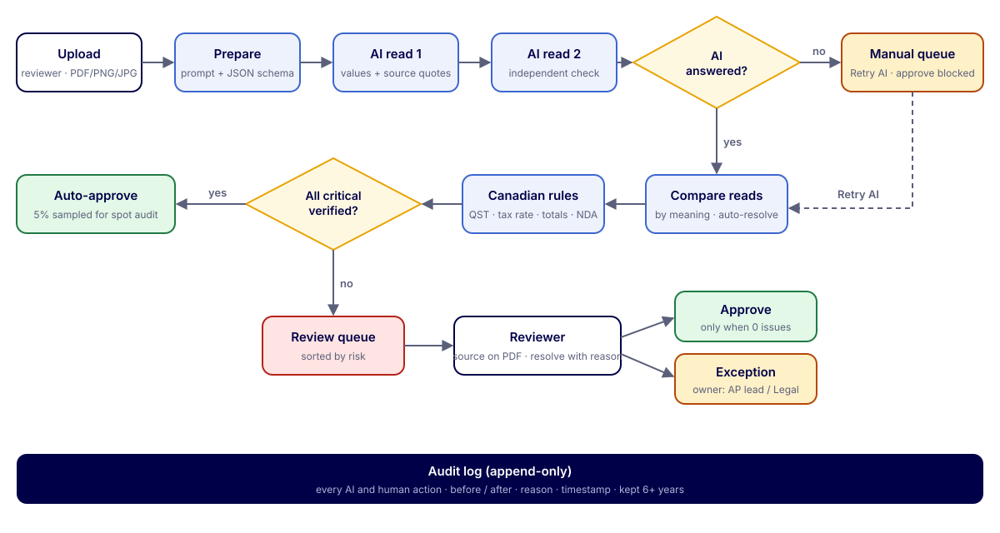
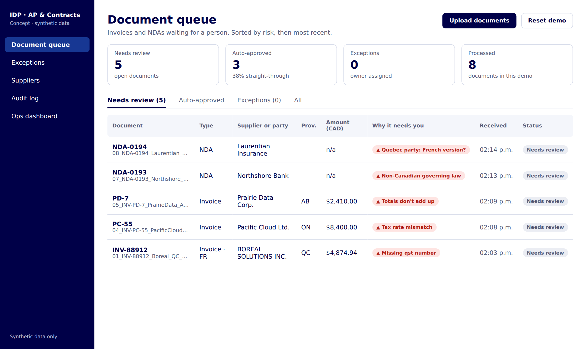
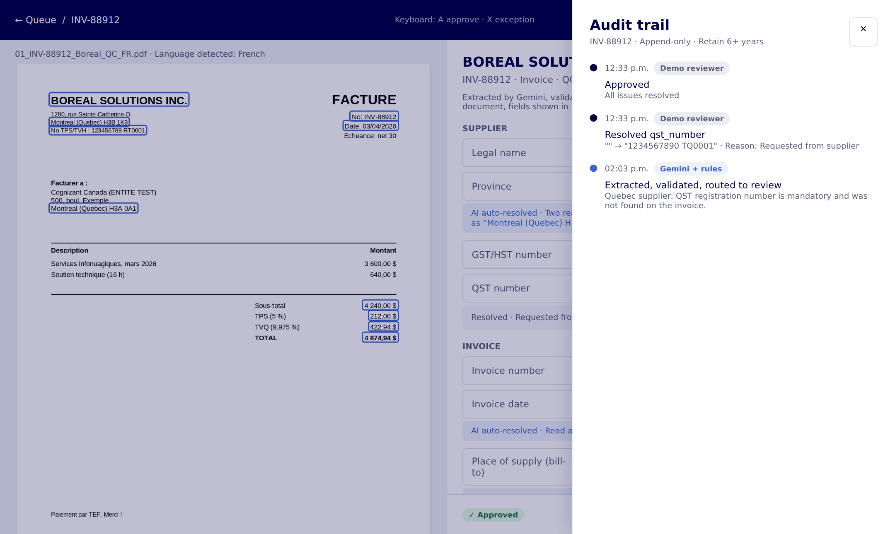
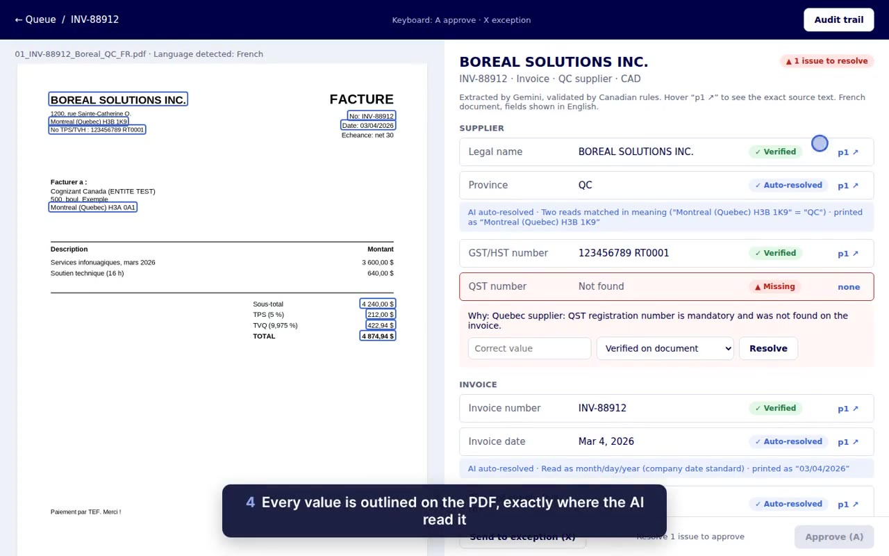

# Case study · Intelligent Document Processing for Canadian AP & Contracts

**Vikram Seenivasan** · AI product case study · Concept project, synthetic data only · [Live site and prototype](https://vikram-pm.github.io/idp-canada-ap-contracts/)

> Personal portfolio project. Not a product of, or built for, any employer. All companies, documents and numbers are fictional.

## Contents
1. Problem · 2. Discovery · 3. Flowchart · 4. Design · 5. Live prototype · 6. AI approach · 7. Canadian rules · 8. Usability test and UAT · 9. KPIs · 10. Business case · 11. Enterprise path · 12. What testing changed · 13. Decisions · 14. Next

## 1. Problem
Back-office teams rekey 15+ fields per invoice and read every NDA end to end (about 9 minutes per invoice, an assumption to validate). In Canada, small errors become real costs: four sales-tax regimes set by place of supply, bilingual documents, and provincial governing law.

**Primary user:** an AP analyst clearing a daily queue. **How might we** let AI handle the routine reading so people only make the judgment calls?

## 2. Discovery
- **Personas:** AP analyst, contracts reviewer, finance controller, privacy office, ops manager.
- **Journeys:** invoice and NDA current-state journeys with pain points and opportunities (FigJam).
- **OOUX:** noun foraging, an 8-object ORCA map and a CTA matrix (who can do what), which became the UI structure and permission model.
- **Insight:** the value is not faster typing; it is a reviewer who only sees documents that need a decision, with the evidence in front of them.

## 3. Flowchart

Three exits: **auto-approve** (5% spot-audited), **review** (approve blocked until every issue is resolved), and **manual** when the AI is unavailable (Retry AI). Every step writes to the append-only audit log.

## 4. Design
Designed in Figma (UX flow, five annotated screens, colour tokens as variables), then built as a working product.

| Queue | NDA review |
|---|---|
|  |  |
| **Audit trail** | **Ops dashboard** |
|  |  |

## 5. Live prototype

**Demo video (90 seconds):** 

- **Web prototype:** the real reviewer UI and rules engine running in the browser, with recorded AI responses for 8 sample documents: [try it](https://vikram-pm.github.io/idp-canada-ap-contracts/#demo).
- **Full build:** n8n workflow with live Gemini calls (`n8n/idp-canada-workflow.json`).
- **Clickable Figma prototype:** 12 interactions from queue to review to audit trail.

## 6. AI approach
Model self-reported confidence is poorly calibrated, so it is not used. A field is **verified** only when it is:
1. **Grounded:** the model returns the exact text it read; reviewers see it outlined on the PDF.
2. **Consistent:** a second, independent read agrees, compared by meaning ("Quebec" = "QC").
3. **Valid:** deterministic Canadian rules pass. The model reads; rules judge.

## 7. Canadian rules
| Rule | Behaviour |
|---|---|
| QST registration number | Mandatory for every Quebec supplier |
| Tax by place of supply | ON 13% HST · NS 14% HST · NB/NL/PE 15% HST · QC 5% GST + 9.975% QST · AB 5% GST |
| Totals | Subtotal + taxes = total within $0.02 |
| NDA | Non-Canadian governing law → Legal; Quebec party → French-version check |
| Formats | Mar 4, 2026 · $4,874.94 · QC/ON · 123456789 RT0001 |
| Information only | GST/HST number, invoice number, possible duplicates (business decision) |

## 8. Usability test and UAT

**Usability test.** Moderated, think-aloud, 30 minutes each, on the clickable prototype. Measures: task success, errors caught, time on task, Single Ease Question (1–7), trust in extracted values (1–5). Three tasks contain a planted AI mistake to test for rubber-stamping.

| # | Task |
|---|---|
| 1 | Find the most urgent document and open it |
| 2 | Decide whether INV-88912 can be approved |
| 3 | Check where a value came from on the PDF |
| 4 | Resolve the missing QST number with a reason |
| 5 | Review the Northshore NDA |
| 6 | Show who changed a value, and when |

| Participant | Role | Tasks completed | Planted errors caught (of 3) | Trust (1–5) | Key quote |
|---|---|---|---|---|---|
| P1 | [role] | [ /6] | [ ] | [ ] | [quote] |
| P2 | [role] | [ /6] | [ ] | [ ] | [quote] |
| P3 | [role] | [ /6] | [ ] | [ ] | [quote] |

**What changed after the sessions:** [add your iteration notes]

**UAT.** Scripted acceptance tests mapped to PRD user stories, run on the live n8n build and the web prototype.

| Story | Scenario | Expected | Result |
|---|---|---|---|
| US-01 | Upload several PDFs or drag onto the page | Queued and processed | Pass |
| US-02 | Find each value on the PDF | Source outlined; no source shows Missing | Pass |
| US-04 | BC supplier billing Ontario at 5% GST | Flagged: expected 13% HST | Pass |
| US-05 | Quebec supplier, no QST number | Review; approve blocked | Pass |
| US-06 | NDA under New York law | Always to review | Pass |
| US-07 | Resolve an issue | Reason required, in audit trail | Pass |
| US-09 | AI unavailable | Manual with Retry; approve blocked | Pass (simulated outage) |
| US-10 | "Quebec" vs "QC", 03/04/2026 | Auto-resolved, explained, Mar 4, 2026 | Pass |

**Defects found and fixed before sign-off:** documents vanished during AI outages; dashboard refresh overwrote new results (race condition); Manual documents hidden from the review tab; a status chip overlapped the source link.

## 9. KPIs
| Layer | KPI | Measurement | Target |
|---|---|---|---|
| North star | Documents closed correctly without rework | approved with zero corrections and no spot-audit error | ≥ 95% |
| Efficiency | Straight-through rate | auto-approved ÷ all | 40–60% |
| Efficiency | Handle time per document | review-task timestamps (audit log) | −30% vs ~9 min |
| Quality | Field-level accuracy | eval script vs ground truth, by language and scan quality | ≥ 95% |
| Quality | Missed-issue rate (false negatives) | planted-error tests + errors in the 5% spot audit | < 1% |
| Trust | Override rate by rule | corrections ÷ flagged fields | trending down |
| Value | ITC / ITR capture | valid registration numbers ÷ invoices charging tax | ≈ 100% |
| Cost | AI + platform cost per document | monthly bill ÷ documents | < CAD $0.25 |
| Reliability | Manual fallback rate | AI-unavailable ÷ all | < 2% |

Current evidence: **8/8 test documents routed correctly** (3 auto-approved, 5 to review for a real reason). Field accuracy at scale and handle time are not yet measured.

## 10. Business case (CAD, re-checked Oct 2026)
**Development cost:** $132K to a production pilot (3.25 people × 12 weeks at $90/h blended). Maintenance ≈ $26K a year.

**ROI by volume and number of users (modelled)**

| Documents / month | Reviewers (today → IDP) | Cost per document | Azure / month | Net savings / year | Payback on build |
|---|---|---|---|---|---|
| 2,000 | 2.1 → 1.0 | $6.00 → $3.07 | $457 | $70K | 36 months |
| 10,000 | 10.7 → 5.1 | $6.00 → $2.95 | $1,092 | $366K | 5 months |
| 50,000 | 53.6 → 25.4 | $6.00 → $2.90 | $3,145 | $1.86M | 1 months |

**PM reading:** fund above ~10,000 documents a month, or as a shared platform. The real straight-through rate can't be known from synthetic data; the new guardrails will lower it somewhat, and the pilot will measure it.

**Pricing and packaging** (if offered to other teams): Starter CAD $1,500/month (5 reviewers, 2,500 docs), Growth CAD $6,000 (25 reviewers, 12,500 docs), Enterprise from CAD $20,000 (60,000+ docs). Gross margin about 70–80% after Azure costs.

**Number check (Oct 2026):** platform costs rebuilt bottom-up from Azure line items (previously a rough estimate). Net savings moved from $69K / $358K / $1.83M to $70K / $366K / $1.86M; payback essentially unchanged; margin corrected from ~75% to 70–80%. Source: `docs/economics.py`.

## 10a. Model fit and cost
| Model | Role | Cost / doc (USD) | Data in Canada |
|---|---|---|---|
| Gemini 2.5 Flash-Lite | Prototype: both reads | $0.0009 | No (free tier) |
| Azure AI Document Intelligence (prebuilt invoice) | Production read 1: invoices | $0.015 | Yes (Canada region) |
| Azure OpenAI GPT-4.1-mini (regional) | Production read 2 + NDAs | $0.0017 | Yes |

Two different models make different mistakes, so they rarely agree on the same wrong value. Choice confirmed by a bake-off on ~200 real documents, ranked by false negatives first, then accuracy, latency and cost. Prices: Document Intelligence ~US$10 per 1,000 pages; GPT-4.1-mini US$0.40/$1.60 per million tokens (≈10% more for regional deployment).

**Architecture today:** no RAG and no separate database. The AI reads each document directly; results are stored in n8n's own storage. RAG is planned only for the NDA playbook (Azure AI Search).

## 10b. Evaluation: false negatives
A false negative is a wrong document that gets auto-approved. I planted 16 errors where **both AI reads agree on the wrong value** (the hardest case) and ran them through the rules (`scripts/fn_test.js`).

| Error type | Result | Next guardrail |
|---|---|---|
| Amounts, tax rate, provinces | Caught by Canadian rules | — |
| Currency, NDA governing law | Caught by new guardrails | — |
| Dates in a normal range | Missed | Verify quote against PDF text |
| Supplier name, GST/HST number | Missed | Match to vendor master |
| Invoice and PO numbers | Missed | Match to PO / ERP |

**Result: 7/16 caught originally → 9/16 after three new guardrails** (non-CAD to review, date sanity checks, NDAs always reviewed in pilot). The remaining 7 need outside data; that gap must close before production.

## 10c. Guardrails
| Technical | Status | Operational | Status |
|---|---|---|---|
| Schema-only output, source quote required | Built | 5% spot audit of auto-approved documents | Built |
| Two independent reads, deterministic rules | Built | Reason code on every correction | Built |
| Currency, date and NDA guardrails | Built | Append-only audit trail | Built |
| Approve locked until issues resolved | Built | Weekly review of misses and overrides | Planned |
| Document text treated as data; model has no tools | Built | No model change without passing the eval | Planned |
| Quote verification, vendor and PO matching | Planned | Tax team signs off the rules | Planned |
| Bank-detail redaction before the model call | Planned | Segregation of duties above a threshold | Planned |

## 10d. Security and Azure cost
**Controls:** data stays in Canada (Canada Central / East) · Entra ID SSO, roles from the CTA matrix · private endpoints, no public access, secrets in Key Vault · encryption at rest and in transit · Azure OpenAI does not train on customer data · immutable storage with 7-year retention for CRA · Quebec Law 25 privacy assessment before real data.

| Documents / month | AI | Platform | Azure total (CAD / month) |
|---|---|---|---|
| 2,000 | $46 | $411 | **$457** |
| 10,000 | $229 | $863 | **$1,092** |
| 50,000 | $1,145 | $2,000 | **$3,145** |

Platform: App Service, database, storage, Key Vault, private endpoints, monitoring. Add ~US$74 a month for Azure AI Search Basic if the NDA playbook RAG is used.

## 10e. AI opportunities
| Opportunity | Value | Status |
|---|---|---|
| Invoice and NDA extraction with validation | High | Built |
| Draft vendor emails for missing details (e.g. QST number) | Medium | Quick win |
| GL coding suggestions from invoice lines | High | Next |
| Fraud signals: bank-detail changes, near-duplicates | High | Next |
| NDA clause check against the legal playbook (RAG) | Medium | Later |
| Ask the queue in Teams with Microsoft Copilot | Medium | Later |

## 11. Enterprise path (Microsoft)
| Layer | Prototype | Enterprise |
|---|---|---|
| Document reading | Gemini 2.5 Flash-Lite (free tier) | Azure AI Document Intelligence + Azure OpenAI, Canada region |
| Workflow | n8n | Power Automate / Azure Logic Apps |
| Reviewer experience | Web UI | Teams app or Copilot Studio agent; Microsoft Copilot for questions in Outlook and Teams |
| Data and audit | n8n storage | SharePoint / Dataverse with retention policies |
| Identity | none (demo) | Microsoft Entra ID, roles from the CTA matrix |

Microsoft 365 Copilot is US$30 per user per month; Copilot Studio is billed in credits (US$200 per 25,000, or $0.01 each), and interactions by licensed users can be zero-rated, so the licence mix is a cost lever to model in a pilot.

## 12. What testing changed
| Finding | Change |
|---|---|
| Two AI reads disagreed on formatting only | Compare by meaning; auto-resolve and explain |
| Gemini overloaded; documents vanished | Route to Manual with Retry AI; approval blocked |
| Dashboard refresh overwrote new results | Page views read a copy; only actions write |
| Manual documents hidden from review | Included in Needs review |

## 13. Decisions and responsible AI
See [DECISIONS.md](DECISIONS.md) and [RESPONSIBLE_AI.md](RESPONSIBLE_AI.md). Key trade-offs: month/day/year dates (printed value always shown), QST mandatory for Quebec, GST/HST number and duplicates as notes (risk accepted and documented), Flash-Lite as default model.

## 14. Next
Validate baselines with AP reviewers · measure accuracy at scale by language and scan quality · language-aware date rule · redact banking data before the model call · pilot on the Microsoft stack at ≥10,000 documents a month.
